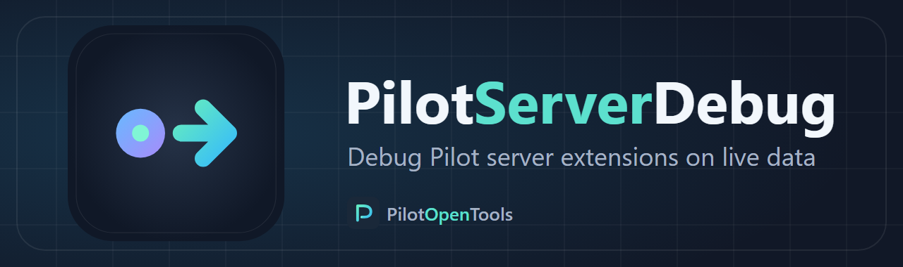

<p align="center"></p>

# PilotServerDebug

[](https://github.com/PilotOpenTools/PilotServerDebug/actions/workflows/ci.yml)
[](https://github.com/PilotOpenTools/PilotServerDebug/releases/latest)

Утилита `debug` запускает серверный модуль Pilot (`*.servext.dll`) на машине разработчика под отладчиком. Модуль получает настоящие `IModifierBase` и `IModifierBackend`, подключённые к серверу Pilot под учёткой разработчика, и точки останова в Visual Studio срабатывают на реальных данных. Сервер не останавливается, модуль на него не выкладывается, доступ к машине с Docker не нужен.

[Скачать релиз](https://github.com/PilotOpenTools/PilotServerDebug/releases/latest) · [История изменений](CHANGELOG.md)

## Зачем

Серверный модуль Pilot выполняется внутри Pilot-Server. Чтобы отладить его обычным способом, нужно выложить сборку на сервер, перезапустить его и подключиться отладчиком к процессу сервера: это долго и мешает остальным пользователям. `debug` выполняет **локальную сборку** модуля из `bin\` проекта, а с сервера берёт только данные: объекты, типы, файлы.

- По умолчанию изменения только показываются (dry-run) и на сервер не пишутся.
- Запись включается явно (`--apply`) и подтверждается перед запуском, на прод - вводом слова `prod`.
- Кейс отладки (`debug.json`: сервер, логин, объект, событие, параметры автоматизации) выдаёт веб-админка [PilotProAdmin](https://github.com/PilotOpenTools/PilotProAdmin) или он пишется вручную.

## Установка

Файлы релиза на странице [Releases](https://github.com/PilotOpenTools/PilotServerDebug/releases/latest):

| Файл | Что это |
|---|---|
| `PilotServerDebug-<версия>.zip` | утилита `debug.exe` с зависимостями, распаковать в любую папку, например `C:\Tools\debug` |
| `SHA256SUMS.txt` | контрольные суммы |

Требования: Windows, **.NET 8 Runtime** (утилита публикуется не самодостаточной) и сетевой доступ к серверу Pilot. Пакет Pilot Server API подключён версии 26.15.

## Без веб-админки

Утилита подключается к серверу Pilot напрямую, админка для неё не обязательна: она только выдаёт готовый
`debug.json` и zip. Без неё соберите утилиту сами (`dotnet publish -c Release`) и задайте всё в
`debug.json` вручную (образец - `debug.example.json`) или ключами:

```bash
debug --server http://сервер:порт/база --login admin --source <guid> --module bin/Debug/Имя.servext.dll
```

## Как пользоваться

1. Скачать `PilotServerDebug-<версия>.zip` со страницы [Releases](https://github.com/PilotOpenTools/PilotServerDebug/releases/latest) (или `debug.zip` в админке, «Серверные модули» / «Локальная отладка») и распаковать, например, в `C:\Tools\debug`.
2. В админке у активности нажать «Отладить локально» / **debug.json** (можно указать Id объекта).
   Галочка «Записывать изменения на сервер» ставит в файле `"apply": true`; без неё - только просмотр.
   Файл не отправляйте и не коммитьте с `"apply": true`: запись перед запуском подтверждается, но флаг лучше включать осознанно.
   Положить файл в папку проекта модуля. В нём адрес сервера контура, ваш логин и `params` / `sourceTypes` / `when`
   из автоматизаций контура. Пароля в файле нет.
3. `Properties/launchSettings.json` проекта модуля:

   ```json
   {
     "profiles": {
       "debug": {
         "commandName": "Executable",
         "executablePath": "C:\\Tools\\debug\\debug.exe",
         "commandLineArgs": ""
       }
     }
   }
   ```

4. F5 с профилем «debug». debug найдёт `debug.json` (в текущей папке или выше) и самый свежий
   `*.servext.dll` в `bin\` рядом с ним, спросит пароль (или возьмёт `DEBUG_PASSWORD`), вызовет `RunAsync`
   и напечатает, что модуль **собирался** записать. На сервер ничего не пишется.

Записать изменения по-настоящему: `--apply` или `"apply": true`. Перед запуском утилита покажет сервер и логин и
спросит подтверждение (`y`); без вопроса - ключ `--yes` (кроме прода, см. «Запись на прод»). Изменения идут от имени разработчика и записываются
**по ходу выполнения**: накопленное в `modifier` уходит на сервер перед
следующим обращением модуля к `modifier`/`backend` и в конце `RunAsync`. Цепочка шагов, где следующий читает
результат предыдущего (версии файлов, атрибуты), видит на сервере уже записанное. На точке останова сразу после
`SetAttribute` изменения ещё нет: оно появится, когда код дойдёт до следующего вызова Pilot или до конца `RunAsync`.
Если F5 не останавливается на точках: `--wait` / Debug / Attach to Process / `debug.exe` (Managed .NET Core).
Остальные ключи: `debug --help`.

**Откуда берутся настройки.** `debug.json` ищется в текущей папке и выше; утилита печатает, какой файл взят, и
предупреждает, если он найден автоматически: `server` из него определяет, куда уйдёт пароль, а `module` - какая dll будет выполнена.
Не запускайте утилиту в папках, которым не доверяете.

**Какой код выполняется.** Всегда локальная сборка модуля из `bin\` вашего проекта. Версия, загруженная на сервер
(через админку или напрямую), не используется. С сервера берутся только данные: объекты, типы, файлы.
Поэтому перед запуском проект нужно собрать (F5 в Visual Studio делает это сам).

## Пример: TestServerAction

```
C:\Tools\debug\debug.exe             / утилита из релиза (или dotnet publish -c Release этого репозитория)
TestServerAction\
├─ TestServerAction.csproj
├─ debug.json                        / из админки, кладётся сюда, рядом с .csproj
├─ Properties\launchSettings.json    / профиль «debug»
└─ bin\Debug\TestServerAction.servext.dll   / именно он и запускается
```

[TestServerAction](https://github.com/PilotOpenTools/PilotProAdmin/tree/main/server-extensions/TestServerAction) - пример серверного модуля из PilotProAdmin.

`debug.json` (как выдала админка):

```json
{
  "server": "http://localhost:5547/pilot-ice_ru",
  "login": "ivanov",
  "module": "bin/Debug/TestServerAction.servext.dll",
  "activity": "TestServerAction",
  "sourceId": "4a912f46-a397-42a8-a8a3-ebf7572cd1d0",
  "when": "StateAttributeChanged",
  "sourceTypes": [ "task_toReviewDocument" ],
  "params": {}
}
```

`sourceId` - объект, на котором будто бы сработало событие. Он должен быть одного из типов `sourceTypes`,
иначе модуль, скорее всего, ничего не сделает. Другой объект: поменять здесь или `--source <guid>`.

`Properties\launchSettings.json`:

```json
{
  "profiles": {
    "debug": {
      "commandName": "Executable",
      "executablePath": "C:\\Tools\\debug\\debug.exe",
      "commandLineArgs": "",
      "workingDirectory": "$(ProjectDir)"
    }
  }
}
```

Дальше:

1. Открыть `TestServerAction.sln`, конфигурация **Debug** (её указывает `module`).
2. Точка останова в `RunAsync`.
3. Выбрать профиль **debug** рядом с и нажать F5.
4. В консоли ввести пароль своей учётной записи Pilot (или заранее задать `DEBUG_PASSWORD`).
5. Отладчик остановится в модуле. В конце консоль покажет изменения, которые модуль собирался записать,
   и под отладчиком будет ждать нажатия клавиши. **По умолчанию на сервер ничего не записывается.**
   Чтобы записать, скачайте json с галочкой «Записывать изменения на сервер» (или впишите `--apply`
   в `commandLineArgs`, или `"apply": true` в json). Перед запуском консоль спросит подтверждение; изменения пишутся
   сразу по ходу выполнения.

### Запись на прод

Админка сама вписывает в `debug.json` поле `"contour"` (`test`, `stage` или `prod`) по контуру, для которого вы
скачали файл. Если там `prod`, запись на сервер подтверждается не ответом `y`, а вводом слова `prod`; ключ `--yes` на прод
не действует. Это сделано для случая, когда `--yes` когда-то прописали в `launchSettings.json` или скрипт для тестового
сервера, а потом подменили адрес на боевой: без осознанного ввода слова ничего не запишется. Нужна запись на прод
без вопроса (скрипт) - отдельный явный ключ `--yes-prod`. Для `test`, `stage` и старых файлов без поля `contour`
всё работает как раньше, просмотр без `--apply` не меняется.
Если задан `--server` с адресом, отличным от `server` в кейсе, и в кейсе есть `contour`, контур считается недостоверным
и запись подтверждается словом `prod`, как для прода. Файл без `contour` защиты не имеет: старые файлы пересоздайте в админке.

## Отличия от сервера

- Права разработчика, а не сервера: недоступный ему объект модуль не увидит.
- `ev.Changes` пустой (изменения, вызвавшие событие, не воспроизводятся); `Target`/`RelationType` - null.
- `GetService<T>()`: есть `IAutomationNotifier` (только печатает) и `IAutomationFileProvider` (файлы с сервера);
  остальные сервисы возвращают null с предупреждением.
- `params` разбираются так же, как на сервере (Newtonsoft: строки с датой / `DateTime`, массивы / `List<object>`,
  вложенные объекты / `Dictionary<string, object>`). Шаблоны (`templates`) сценария не подставляются.
- Внешние вызовы модуля (почта, HTTP, файлы) выполняются по-настоящему.
- В режиме записи изменения уходят несколькими пакетами по ходу выполнения, а сервер применяет все изменения
  активности одним пакетом после `RunAsync`. Если активность упадёт, уже записанные шаги останутся на сервере.
- Builder, полученный до обращения к Pilot (`var b = modifier.EditObject(x); backend.GetObject(...); b.SetAttribute(...)`),
  в режиме записи теряет изменения: после записи пакета он уже не связан с `modifier`. Берите `EditObject` заново.

## Сборка и тесты

```powershell
dotnet build Debug.sln -c Release
dotnet test Debug.sln -c Release --no-build
dotnet publish Debug.csproj -c Release      # dist\debug.zip
```

Утилита публикуется не самодостаточной: на машине разработчика нужен .NET 8 Runtime.

## Выпуск

1. Поднимите `<Version>` в [Debug.csproj](Debug.csproj) и добавьте в [CHANGELOG.md](CHANGELOG.md) раздел `## [X.Y.Z] - дата`.
2. Поставьте и отправьте тег:

   ```powershell
   git tag -a vX.Y.Z -m "vX.Y.Z"
   git push origin main vX.Y.Z
   ```

3. Workflow [release.yml](.github/workflows/release.yml) сверит тег с версией, соберёт и проверит решение и опубликует релиз с `PilotServerDebug-<версия>.zip` и контрольными суммами. Описание берётся из раздела версии в `CHANGELOG.md`.

## Связь с PilotProAdmin

`DebugCaseBuilder.cs` в [PilotProAdmin](https://github.com/PilotOpenTools/PilotProAdmin) формирует `debug.json` в формате `DebugCase.cs` этого репозитория: при изменении формата правьте оба файла.

## Участие

Правила участия: [CONTRIBUTING.md](https://github.com/PilotOpenTools/.github/blob/main/CONTRIBUTING.md). Кодекс поведения: [CODE_OF_CONDUCT.md](https://github.com/PilotOpenTools/.github/blob/main/CODE_OF_CONDUCT.md).

## Лицензия

Проект распространяется по лицензии [Apache 2.0](LICENSE).
